# pixelfx-generator

[English](README.md) | 日本語

すべてをコードで描く、ピクセルアートのエフェクト生成ツールです。シードごとに違うエフェクトが生まれ、その数は約215億。形、素材、
タイミング、パレットのすべてが、その1つの数字から決まります。

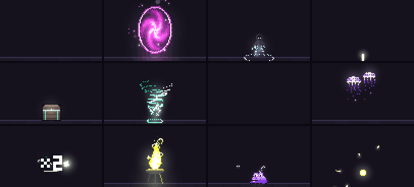

`index.html` をブラウザで開くだけで動きます。ビルドもインストールも不要です。フォントは Google Fonts から読み込み、それ以外は
すべてページ内で動きます。

## 作れるもの

**560のエフェクトタイプ**:70の形 × 8つの素材。タイプごとに、それぞれの幅でバリエーションが生まれます。

| | 形 |
|---|---|
| 単発 | ストライク、スラム、ノヴァ、イラプション、シャター、スラッシュ、ビーム、ピラー、爆縮、スパイク、花火、大波、チェイン、クロー、メテオ、地震、ダッシュ、スターバースト、ワープ |
| UI(単発) | アイテム取得、レベルアップ、ダメージ表示、回復、コンボ、カウントダウン、宝箱、ハートブレイク、ポーション、解錠、星評価 |
| 画面トランジション(単発) | ワイプ、アイリス、ディゾルブ、ブラインド、チェッカー、ダイヤ、時計ワイプ、カーテン、スパイラル、ドリップ |
| シームレスループ | オーラ、ポータル、ヴォルテックス、シジル、かがり火、オーブ、結界、ミサイル、噴水、雲、ビーコン、光の群れ、ブレス、ラダー、コア、水面、スキャン、滝 |
| クリーチャー(ループ) | コウモリ、スライム、ゴースト、蛾、カエル、鳥、蝶、跳ねる魚、ホタル、クラゲ、ヘビ、クモ |

**単発**

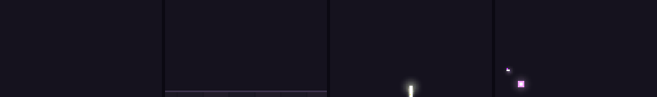

**シームレスループ**

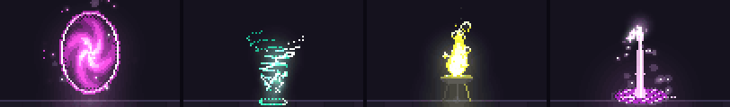

**UI**

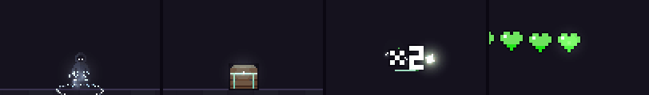

**画面トランジション**

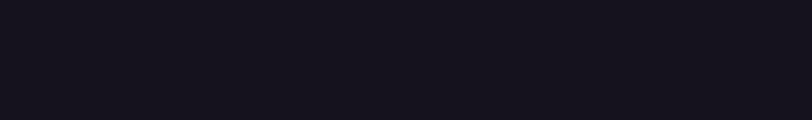

**クリーチャー**

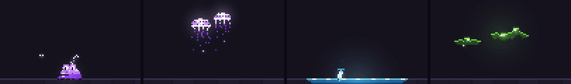

素材は **炎**、**氷**、**雷**、**土**、**虚無**、**毒**、**聖**、**水** の8つ。素材によって、エフェクトから飛び散るものが変わります。
冷えて煙になる炎、光る蒸気と舞い落ちる氷片、稲妻、土煙、明るい縁取りの黒い煙、ふくらんで弾ける泡、明滅するきらめき、
床で跳ねる水滴などです。

新しく加わった形:

- **スラッシュ**:きらめきのあと、三日月の斬撃が百分の数秒で走り、白く光って冷え、尾のほうから崩れながら軌道に火花を散らします。
- **ビーム**:発射口にエネルギーが集まり、波打つビームが最大1秒ほど命中点に注ぎ込み、火花を跳ね返して、最後は点線になって消えます。
- **ピラー**:点線のガイドの下で床に印が灯り、空から光の柱が叩きつけられ、また上へ引いていきます。
- **爆縮**:光の筋と輪が中心へ流れ込み、黒い球が白い一点へ潰れて、弾けます。
- **スパイク**:床を一本の線が走り、その後ろから刃が波のように突き上がり、一斉に光って砕けます。
- **花火**:玉がパチパチと尾を引いて昇り、垂れ下がる星に割れ、燃え尽きながら弾けます。
- **大波**:床がふくらみ、泡を乗せた波頭が床を転がっていき、しぶきと砂礫を散らします。
- **チェイン**:手に電荷がたまり、アークが標的の列を次々に跳び、当たった標的がそれぞれ光ります。
- **クロー**:白熱した3本の爪痕が1本ずつ引き裂き、冷えて閉じ、点線の傷跡を残します。
- **メテオ**:燃える岩が彗星の尾を引いて飛び込み、床に激突して、赤く光るクレーターを残します。
- **地震**:地面がうなり、2つの衝撃波が床を走って盛り上げ、砂礫を蹴り上げます。
- **ダッシュ**:人物が身をかがめ、床を残像とともに駆け抜けて命中点に着地します。
- **スターバースト**:光が集まって回り、回転する星が飛び出し、減速してきらめきながら舞い落ちます。
- **ワープ**:光の柱が降り、走査線が人物を描き出していきます。白熱した行が、人物自身の色へ冷えていきます。
- **アイテム取得**:床でコインか宝石が揺れてきらめき、跳ね上がって回り、きらめきに弾けて「+N」を残します。
- **レベルアップ**:人物のまわりに光が集まり、光の柱が立ち上り、「レベルアップ!」が1文字ずつ落ちてきます。
- **ダメージ表示**:ダメージの数字が飛び出し、行き過ぎてから浮かび去ります。会心の一撃では数字が2倍になり、「会心!」と出て
  光ります。UI系のエフェクトは、インクの縁取りがついた小さな3 × 5ピクセルの内蔵フォントを使います。
- **回復**:光の十字が人物のまわりを昇り、人物が光って、「+N」が浮かび上がります。
- **コンボ**:連撃が次々に当たり、カウンターが上がっていきます。ヒットの合間にはタイマーバーが減っていき、最後に合計が叩きつけられて震えます。
- **カウントダウン**:「3」「2」「1」が拍ごとにズームインし、それぞれから輪が広がって、最後に「GO!」が弾けます。
- **宝箱**:宝箱が揺れて合わせ目から光が漏れ、ふたが開いて光があふれ、コインが噴き出して跳ね、「+N」が昇ります。
- **ハートブレイク**:並んだハートが脈打ち、最後の1つが明滅してひびが入り、2つに割れて空のハートが残ります。
- **ポーション**:フラスコが泡立って栓が飛び、ガラスごと弾けて、素材がらせんを描いて昇ります。
- **解錠**:鍵が南京錠に差し込まれて回り、つるが跳ね上がって開き、錠が浮かんで消えます。
- **星評価**:3つの枠に、獲得した星が1つずつ弾むように満ちていき、最後の1つが接触の瞬間に入ります。
- **ワイプ**、**アイリス**、**ディゾルブ**:画面トランジションです。燃える縁(傾いた帯、閉じていく円、1点から広がる四角)の後ろで
  画面がパレットの一番暗い色に覆われ、ヒットストップのあいだ止まり、同じように晴れていきます。透明な背景で書き出せば、
  トランジションのスプライトシートをそのままオーバーレイに使えます。
- **ブラインド**、**チェッカー**、**ダイヤ**、**時計ワイプ**、**カーテン**、**スパイラル**、**ドリップ**:1つのルールでできた
  トランジションです。どのピクセルにも覆いが届く瞬間があり(上から埋まる羽板、2回に分けて広がる四角、画面を横切るダイヤ、
  回る針、中央で合わさる2枚の幕、らせん状に閉じるマス、流れ落ちる縦の筋)、同じ順番でまた晴れていきます。
- ループ:**かがり火**(脚のついた炎の器)、**オーブ**(輪の中で回る結晶)、**結界**(攻撃を受け止めるガラスのドーム)、
  **ミサイル**(飛行中の弾)、**噴水**(水盤の上で弧に分かれる噴流)、**雲**(素材を降らせる湧き立つ雲)、**ビーコン**
  (光の柱と昇る光の輪を持つ台座)、**光の群れ**(8の字を描く光の粒)、**ブレス**(噴き出し口から注ぐ流れ)、**ラダー**
  (2本の棒を昇るアーク)、**コア**(回る檻の中で脈打つ核)、**水面**(しずくが落ちて輪が広がる水たまり)、**スキャン**
  (人物をなぞる走査線)、**滝**(縁からあふれて泡になる素材)。
- クリーチャー:**コウモリ**(羽ばたき、目を光らせてループ軌道を飛ぶ)、**スライム**(身をかがめ、跳び、着地でつぶれて
  まばたきする)、**ゴースト**(裾をなびかせて揺れ、ふっと薄れるシーツ)、**蛾**(街灯のランプのまわりを回る)、**カエル**
  (のどをふくらませ、まわりを飛ぶハエに舌を伸ばす)、**鳥**(空を横切って反対側から戻ってくる群れ)、**蝶**(揺れる花の
  まわりを舞う)、**跳ねる魚**(池から弧を描いて跳び、しぶきを上げて戻る)、**ホタル**(草の上で明滅する)、**クラゲ**
  (かさを脈打たせて昇り、触手をたなびかせる)、**ヘビ**(床を這って横切り、舌をちろちろ出す)、**クモ**(糸で降りてきて
  また昇っていく)。

### シードがエフェクトになるまで

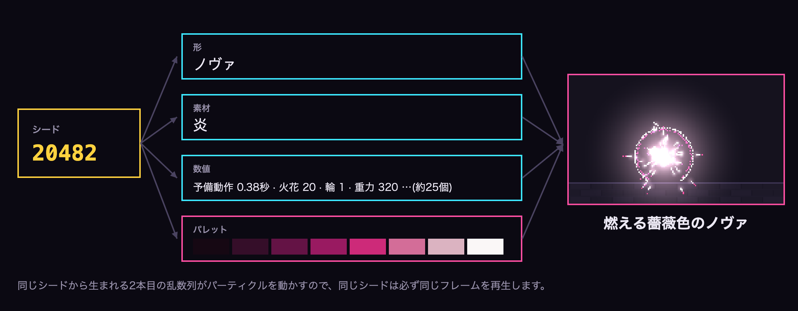

### シードの世代

シードは共有できるので、形を増やしても古いシードが変わってはいけません。新しい形を加えるたびに、専用のシード範囲を割り当てています:

| 世代 | シード | 選ばれる範囲 |
|---|---|---|
| 第1世代 | 1 〜 2,147,483,647 | 9つの形、5つの素材 |
| 第2世代 | 2,147,483,648 〜 4,294,967,295 | 16の形、8つの素材 |
| 第3世代 | 4,294,967,296 〜 8,589,934,591 | 27の形、8つの素材 |
| 第4世代 | 8,589,934,592 〜 12,884,901,887 | 37の形、8つの素材 |
| 第5世代 | 12,884,901,888 〜 17,179,869,183 | 47の形、8つの素材 |
| 第6世代 | 17,179,869,184 〜 21,474,836,479 | 70の形、8つの素材 |

どのシードも、その世代が加わったときとまったく同じように再生されます。「生成」とバリエーションの列は最新の世代からシードを選び、
古いシードもリンクやシード欄からそのまま開けます。

シードごとに8段階のパレットも作られます。明るさは黒に近い色から白に近い色へ上がり、彩度は中ほどで最も高く、
ハイライトでは色相が黄色寄りになります。

## ページの使い方

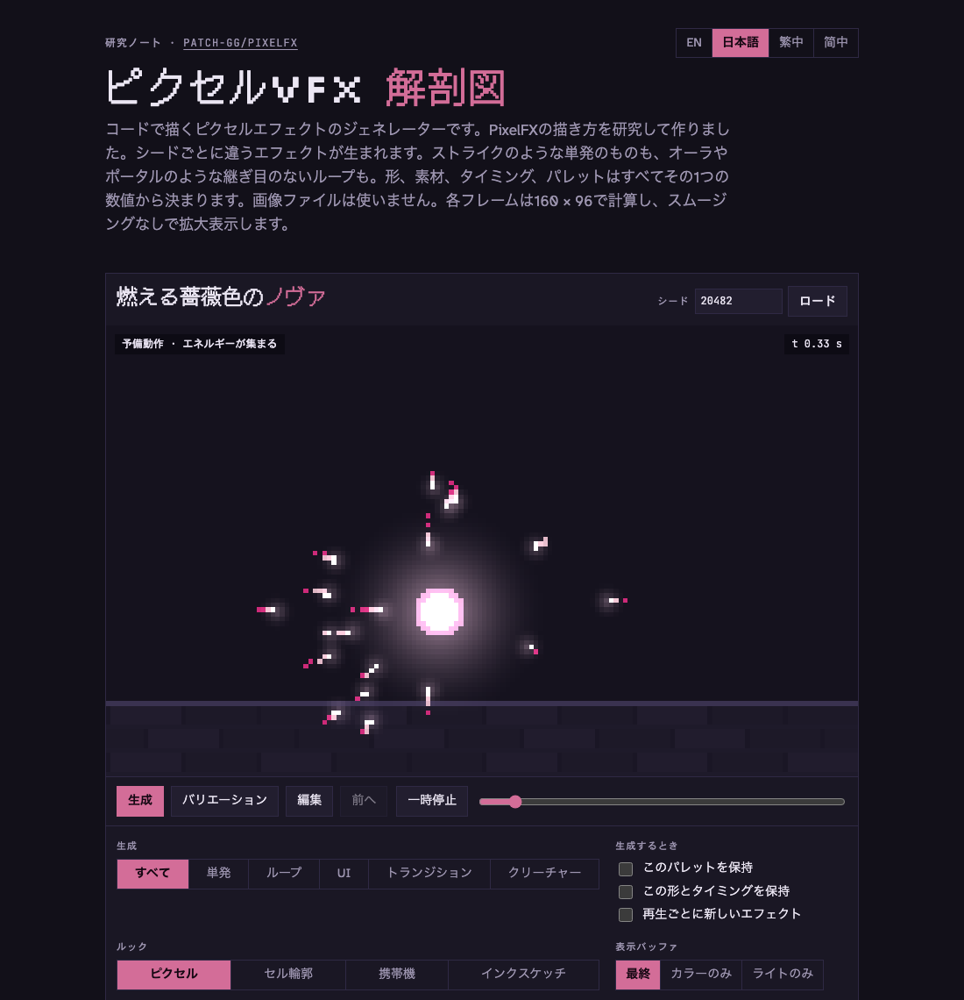

- 新しいエフェクトを **生成** するか、エフェクトはそのままで数値だけを少し変える **バリエーション** を作れます。
- **パレット** か **形** のどちらかを保持したまま、もう一方を変えられます。
- **すべて**、**単発**、**ループ**、**UI**、**トランジション**、**クリーチャー** から選べます。それぞれが独立したカテゴリーなので、
  単発とループにはエフェクトだけが入ります。
- 6つのバリエーションが同時に再生され、クリックするとそれを開きます。
- シードを入力するか、リンクを共有します。リンクの末尾は `#s` とシード番号で、同じエフェクトがそのまま開きます。
- レシピを JSON でコピーできます。
- 光バッファ、ディザ、ヒットストップをオフにして、それぞれの役割を確かめられます。
- **ルック** を **ピクセル**、**セル輪郭**、**携帯機**、**インクスケッチ** から切り替えられます。
- ページの **言語** を English、日本語、繁體中文、简体中文 から切り替えられます(右上)。
- 形、素材、パレット、タイミングを手で編集できます。
- エフェクトを、フレームデータつきのスプライトシートか GIF で書き出せます。

## 編集

**このエフェクトを編集** パネルはコントロールの下に開いていて(**編集** ボタンでそこへ移動します)、シードを保ったまま
今のエフェクトを変えられます:

- **形** と **素材**:70の形と8つの素材のどれにでも変えられます。形を変えると、シードから新しい数値一式が引かれます。素材を
  変えたときは形の数値をそのまま残し、素材が決める数値(煙の塊、煙、火の粉、稲妻など)だけを更新します。**なし** を選ぶと
  素材をまったく使いません。形の火花、輪、ひび、破片、光は残り、ループでは素材の代わりに素朴な光の粒が出て、名前から形容詞が
  外れます(例:「薔薇色のノヴァ」)。シードがなしを選ぶことはなく、選べるのはエディタだけです。
- **パレット**:色相を回したり、彩度を変えたり、8色のどれかを直接選んだりできます。
- 今の形に合った **ノブ**:位置、大きさ、パーティクルの数。単発ではさらに予備動作、注ぐ時間、火花の速さ、重力、ヒットストップ、
  画面の揺れ、向き。ループではループの長さ、1ループあたりの周期数、回転方向。どんな設定でもループはつなぎ目なく続きます。
- UI系の **数値** と **ヒット**:ダメージ表示、アイテム取得、回復、コンボ、宝箱に表示する数字を入力できます(最大6桁。入力した
  とおりに表示され、欄を空にするとシード本来の数字に戻ります)。ダメージ表示は **通常** と **会心** を切り替えられます。どちらも
  リンクに残ります。例:`#s20482~crit:1,num:9999,shape:damage`。

編集内容はリンクのシードの後ろに保存されます。例:`#s20482~hue:60,shape:beam,size:1.4`。編集したエフェクトも共有でき、
そのまま正確に開きます。編集のない `#s` リンクは、シードをそのままの状態で開きます。レシピの JSON と書き出しには編集内容が
含まれ、書き出したファイル名には `-edited` がつきます。**シードの状態に戻す** で編集を消し、**生成** で新しく始めます。

## 言語

ページは英語、日本語、繁体字中国語、簡体字中国語に対応しています。右上の切り替えで、ラベル、キャプション、解説、エフェクト名の
すべてが変わります(「Burning Rose Nova」は 燃える薔薇色のノヴァ、燃燒的玫瑰新星、燃烧的玫瑰新星 になります)。初回はブラウザの
言語に合わせ、選んだ言語はその端末に記憶されます。

UI系のエフェクトが描く文字も、選んだ言語になります。**LEVEL UP!** は レベルアップ!、升級!、升级! に、**CRIT!** は 会心!、
暴擊!、暴击! になります。これらの文字は、このページのために手で描いた12ピクセルのグリフを使っています。書き出しには表示中の
言語が使われ、JSON には `"language"` として記録されます。リンクはどの言語でも同じです。

## ルック

同じエフェクトを4つのルックで仕上げられます。ルックはフレームの最後の描き方だけを変えるので、どのシード、編集、エフェクトにも
そのまま使えます。

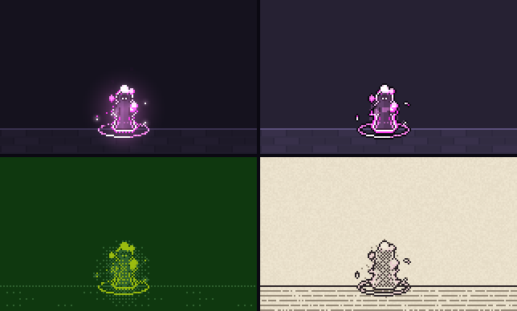

*上段:ピクセル、セル輪郭。下段:携帯機、インクスケッチ。*

- **ピクセル**(標準):半透明は Bayer ディザに分解され、光はなめらかに減衰します。
- **セル輪郭**:トゥーン調です。3分の1以上覆われた部分は塗りつぶされた形になり、すべての形に1ピクセルのインクの輪郭がつきます。
  光は3段階の平らな帯に分けられ、煙や蒸気は輪郭のある塗りの塊になります。インクが映えるよう、背景は少し明るくなります。
- **携帯機**:昔の携帯ゲーム機の画面のような、1つの緑の4階調です。各ピクセルの明るさで階調が決まり、隣り合う階調のあいだは
  4 × 4 の Bayer パターンで選ぶので、光や煙は今もディザの段階で薄れていきます。
- **インクスケッチ**:ざらついた紙に描いた絵です。すべての形にインクの輪郭と、色が暗いほど濃くなるクロスハッチングがつくので、
  白熱した芯は紙の地のまま残ります。光は薄いハッチングから点描へと薄れ、地面は薄いインクで罫線が引かれます。パレットの色が
  ごく淡く重なり、エフェクトごとの色味がわずかに残ります。透明なシートでは紙が消え、インクと塗りの形だけが残ります。

**携帯機** と **インクスケッチ** では、エフェクト自身の色は各ピクセルの明暗を決めるだけなので、エディタのパレットはルックの色に
切り替わります。画面の4階調か、紙、輪郭のインク、ハッチング、薄いインクです。色相、彩度、各色見本は、こちらを変えます
(琥珀色や青の画面、クリーム色の紙に青いインクなど)。解説のパレット帯とページのアクセントカラーもそれに合わせて変わり、
**シードの状態に戻す** で元に戻ります。これらの色はエフェクトではなくルックに属するので、新しいエフェクトを生成しても残り、
リンクにも保存されます(`lhue`、`lsat`、`l0`〜`l3`。例:`#s20482~lhue:120,look:handheld`)。書き出しの JSON には
`"lookPalette"` として記録されます。

ルックはリンクに保存され(`#s20482~look:cel`)、新しいエフェクトを生成しても変わらず、バリエーションの列と書き出しにも
使われます。書き出したファイル名にはルック名(`-cel`、`-handheld`、`-ink`)が、JSON には `"look"` が入ります。

## 書き出し

フレームレート(12、24、30 fps)と倍率(1×、2×、4×)を選んで、ダウンロードします:

- **スプライトシートPNG**:フレームを正方形に近いグリッドに並べたもの。透明な背景か、ページの背景つきで書き出せます。透明な
  背景では光がアルファになり、黒の上では正確に、暗い背景の上ならほぼそのとおりに見えます。
- **シートJSON**:Aseprite の配列形式(フレームの矩形、ミリ秒単位のフレームごとの長さ、フレームタグ1つ)なので、Aseprite の
  シートを読めるエンジンやインポーターで読み込めます。追加の `effect` ブロックに、fps、ループかどうか、接触フレーム、
  画面の揺れ、レシピ全体が入ります。
- **GIF**:ページと同じ見た目で、背景と画面の揺れも含み、無限にループします。パレットは最大256色の1つだけで、色が多い
  エフェクトはメディアンカットで減色します。

ループはちょうど1周期を書き出し、つなぎ目なく繰り返します。単発は空の最後のフレームまで続き、1フレームは必ず接触の瞬間に
重なるので、白いヒーローフレームが飛ばされることはありません。シートには画面の揺れを入れないので、ゲーム側でカメラを
動かせます。書き出しはページのディザとヒットストップの設定に従います。フレームの長さはミリ秒単位(GIF では百分の1秒単位)に
丸められますが、合計は常に正確な再生時間になります。

## 描き方の仕組み

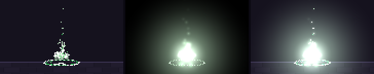

*色バッファ · 光バッファ · 最終画像。*

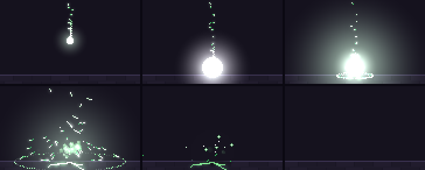

*単発エフェクトの流れ:予備動作、接触の瞬間の白いヒーローフレーム、放出、拡散、保持、そして空の最後のフレーム。*

- **2つのバッファ**:くっきりしたピクセルは色バッファに、光は光バッファに入り、最後に上から足されます。
- **組織的ディザ**:半透明はブレンドではなく 4 × 4 の Bayer パターンです。ただし煙、蒸気、土煙だけは例外で、本当に半透明な
  やわらかい円です。
- **段階的なランプ**:コードはパレットの1段を選び、2段のあいだを混ぜることはしません。
- **単発は物理演算**:パーティクルはシード付きの乱数列から、固定の120 Hzで進みます。同じシードは必ず同じフレームを再生し、
  シークで戻っても同じフレームになります。
- **ループは時間だけで決まる**:ループのフレームはすべて時間だけから計算され、周期で折り返されます。動く部品はどれも1周期に
  整数回だけ巡るので、最後のフレームが最初のフレームへ自然につながります。
- **振り付け**:単発は、予備動作、ヒットストップと画面の揺れを伴う白いヒーローフレーム、放出、拡散、保持、減衰の順に進み、
  空のフレームで終わります。

## クレジット

描画の技法(2つのバッファ、組織的ディザ、段階的なランプ)と、火花、炎、煙のパーティクルの表現は、
[patch-gg/pixelfx](https://github.com/patch-gg/pixelfx) と、Hugo Duprez による
[Sprite Fusion の pixel art VFX](https://www.spritefusion.com/pixel-art-vfx) を研究して学んだものです。どちらも MIT
ライセンスです。どちらのコードもここには含まれていません。
