# pixelfx-generator

English | [日本語](README.ja.md)

A generator for pixel-art effects, drawn entirely in code. Every seed gives a different effect, and there are about
21.5 billion of them. Its shape, material, timing and palette all come from that one number.

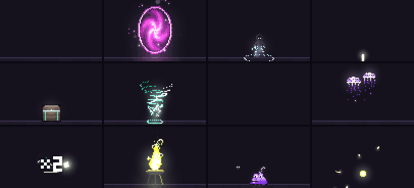

Open `index.html` in a browser. There is no build step and nothing to install. The page loads its fonts from Google
Fonts and runs everything else inline.

## What it makes

**560 effect types**: 70 shapes × 8 materials, each with its own range of variations.

| | Shapes |
|---|---|
| One-shots | strike, slam, nova, eruption, shatter, slash, beam, pillar, implosion, spikes, firework, wave, chain, claw, meteor, quake, dash, starburst, warp |
| UI pops (one-shots) | pickup, level up, hit number, heal, combo, countdown, treasure chest, heartbreak, potion, unlock, star rating |
| Screen transitions (one-shots) | wipe, iris, dissolve, blinds, checker, diamonds, clock wipe, curtain, spiral, drip |
| Seamless loops | aura, portal, vortex, sigil, brazier, orb, ward, missile, fountain, cloud, beacon, swarm, breath, ladder, core, pool, scan, cascade |
| Critters (loops) | bats, slime, ghost, moths, frog, birds, butterflies, leaping fish, fireflies, jellyfish, snake, spider |

**One-shots**

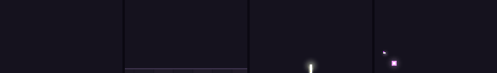

**Seamless loops**

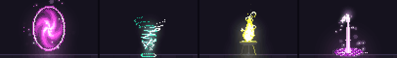

**UI pops**

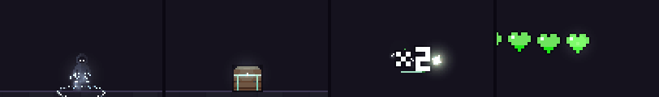

**Screen transitions**

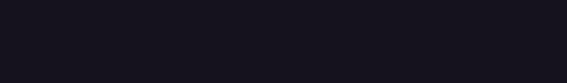

**Critters**

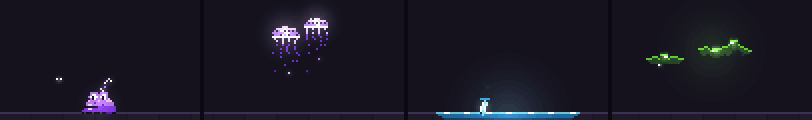

Materials are **flame**, **frost**, **storm**, **dust**, **void**, **poison**, **holy** and **water**. They change
what the effect throws off: fire that cools into smoke, glowing vapour and falling flakes, lightning, dust clouds,
dark puffs with bright rims, bubbles that swell and pop, pulsing glints, or drops that splash on the floor.

The newer shapes:

- **Slash**: a glint, then a crescent sweeps in a few hundredths of a second, flashes white, cools and comes apart
  from its tail, throwing sparks off its path.
- **Beam**: energy gathers at a muzzle, then a rippling beam pours into the hit for up to a second, spraying sparks
  back, and gives out as a dotted line.
- **Pillar**: a mark lights on the floor under a dotted guide line, then a column slams down from the sky and draws
  back up.
- **Implosion**: streaks and rings rush in, a dark sphere collapses onto a white point, then it pops.
- **Spikes**: a line races along the floor, blades burst up behind it in a wave, flash together and shatter.
- **Firework**: a shell climbs on a fizzing trail and bursts into drooping stars that crackle as they burn out.
- **Wave**: the floor swells, then a crest rolls across it with foam on top, throwing spray and grit.
- **Chain**: a charge builds in a hand, then an arc leaps through a line of targets, each flashing as it is hit.
- **Claw**: three white-hot marks rake down one after another, cool, close up and leave a dotted scar.
- **Meteor**: a burning rock streaks in on a comet tail and smashes into the floor, leaving a glowing crater.
- **Quake**: the ground rumbles, then two shock fronts run out along the floor, heaving it up and kicking grit.
- **Dash**: the figure crouches, blurs across the floor and lands on the hit, leaving fading after-images.
- **Starburst**: light gathers and turns, then spinning stars fly out, slow, twinkle and drift down.
- **Warp**: a beam slams down and a scan line paints the figure in, white-hot rows cooling to its own colours.
- **Pickup**: a coin or gem bobs and glints on the floor, then leaps, spins, bursts into glints and leaves a "+N".
- **Level up**: light gathers round the figure, a column of light shoots up and "LEVEL UP!" drops in letter by
  letter.
- **Hit number**: a damage number pops, overshoots and floats off; a critical hit doubles it, says "CRIT!" and
  flashes. The UI effects use a small built-in 3 × 5 pixel font with an ink outline.
- **Heal**: crosses of light rise round the figure, it glows, and a "+N" floats up.
- **Combo**: hits land one after another round a counter that climbs, its timer bar draining between hits, then the
  total slams in and shakes.
- **Countdown**: "3", "2", "1" zoom in on their beats with a ring running out from each, then "GO!" bursts.
- **Treasure chest**: the chest shakes and leaks light at the seam, the lid flips open, light pours up, coins
  fountain out and bounce, and a "+N" rises.
- **Heartbreak**: a row of hearts beats; the last one flickers, cracks and splits in two, leaving an empty heart.
- **Potion**: a flask bubbles and pops its cork, then bursts into glass and a rising spiral of the material.
- **Unlock**: a key slides into a padlock and turns, the shackle springs open and the lock lifts away.
- **Star rating**: three slots; the stars won fill one by one, each punching in, the last on contact.
- **Wipe**, **iris** and **dissolve**: screen transitions. The screen fills with the palette's darkest tone behind a
  burning edge (a tilted band, a closing circle, or squares growing out from a point), holds for the hit-stop, then
  clears the same way. Exported on a transparent ground, a transition's sprite sheet works as an overlay.
- **Blinds**, **checker**, **diamonds**, **clock wipe**, **curtain**, **spiral** and **drip**: more transitions
  built on one rule. Every pixel has a moment when the cover reaches it (slats filling top to bottom, squares growing
  in two turns, diamonds sweeping across, a hand going round, two drapes meeting, cells closing in a spiral, columns
  running down), and it clears again in the same order.
- Loops: **brazier** (a flame bowl on legs), **orb** (a turning crystal in rings), **ward** (a glass dome that takes
  hits), **missile** (a projectile in flight), **fountain** (a jet breaking into arcs over a basin), **cloud** (a
  boiling cloud raining the material), **beacon** (a pad with a column and rising rings of light), **swarm** (motes
  on figure-of-eight paths), **breath** (a stream pouring from a spout), **ladder** (an arc climbing two rods),
  **core** (a beating core in a turning cage), **pool** (drops landing in a pool with spreading rings), **scan** (a
  scan line sweeping a figure) and **cascade** (the material pouring over a lip into foam).
- Critters: **bats** (on looping flight paths, wings beating, eyes glowing), **slime** (crouches, leaps, splats and
  blinks), **ghost** (a sheet with a waving hem that bobs and fades), **moths** (circling a lamp on a post),
  **frog** (throat swelling, tongue flicking at a circling fly), **birds** (a flock crossing the sky and wrapping
  round), **butterflies** (round swaying flowers), **leaping fish** (arcing out of a pond and splashing back),
  **fireflies** (blinking over grass), **jellyfish** (bells pulsing upward, tentacles trailing), **snake**
  (slithering across the floor, tongue flicking) and **spider** (dropping on a thread and climbing back).

### How a seed becomes an effect

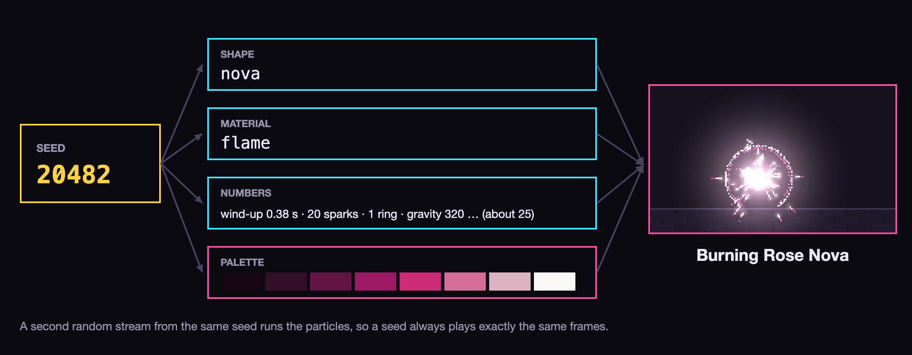

### Generations of seeds

Seeds are shareable, so adding shapes must not change old ones. Each batch of new shapes gets its own seed range:

| Generation | Seeds | Draws from |
|---|---|---|
| First | 1 to 2,147,483,647 | 9 shapes, 5 materials |
| Second | 2,147,483,648 to 4,294,967,295 | 16 shapes, 8 materials |
| Third | 4,294,967,296 to 8,589,934,591 | 27 shapes, 8 materials |
| Fourth | 8,589,934,592 to 12,884,901,887 | 37 shapes, 8 materials |
| Fifth | 12,884,901,888 to 17,179,869,183 | 47 shapes, 8 materials |
| Sixth | 17,179,869,184 to 21,474,836,479 | 70 shapes, 8 materials |

Every seed plays exactly as it did when its generation was added. Generate and the variations strip pick seeds from
the newest generation; older seeds still open from a link or the seed box.

Each seed also builds its own eight-step palette. Lightness climbs from near black to near white, saturation peaks
in the middle, and the hue leans toward yellow in the highlights.

## Using the page

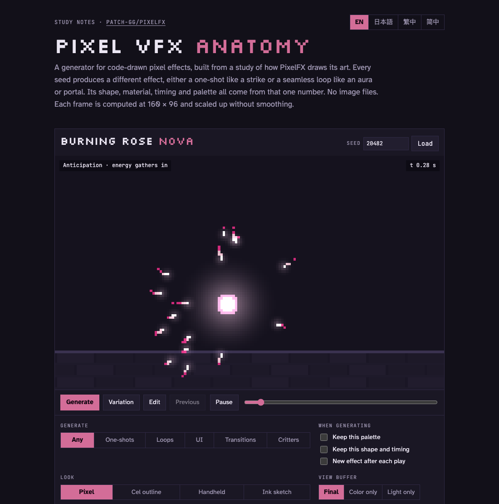

- **Generate** a new effect, or a **Variation** that keeps the effect and nudges its numbers.
- Keep the **palette** or the **shape** while changing the other.
- Pick **any**, **one-shots**, **loops**, **UI**, **transitions** or **critters**. Each family is its own category,
  so one-shots and loops are the effects alone.
- Watch six more variations play at once, and click one to open it.
- Type a seed, or share the link: it ends in `#s` plus the seed and reopens the same effect.
- Copy the recipe as JSON.
- Switch off the light buffer, the dither or the hit-stop to see what each one does.
- Switch the **look** between **Pixel**, **Cel outline**, **Handheld** and **Ink sketch**.
- Switch the page's **language** between English, 日本語, 繁體中文 and 简体中文 (top right).
- Edit the effect by hand: shape, material, palette and timing.
- Export the effect as a sprite sheet with frame data, or as a GIF.

## Editing

The **Edit this effect** panel sits open under the controls (the **Edit** button jumps to it), and changes the current
effect without leaving its seed:

- **Shape** and **material**: any of the 70 shapes and 8 materials. A new shape gets a fresh set of numbers drawn
  from the seed; a new material keeps the shape's numbers and only refreshes the ones the material decides (puffs,
  smoke, embers, lightning and so on). Pick **None** for no material at all: the shape keeps its sparks, rings,
  cracks, shards and light, loops keep plain motes of light where the material would be, and the name drops its
  adjective (for example "Rose Nova"). Seeds never pick None; only the editor does.
- **Palette**: turn the hue, scale the saturation, or pick any of the eight colours directly.
- **Knobs** for the shape in hand: position, size, particle count, and for one-shots the wind-up, pour time, spark
  speed, gravity, hit-stop, screen shake and facing; for loops the loop length, cycles per loop and spin. Loops stay
  seamless whatever the settings.
- **Number** and **Hit** for the UI pops: type the number a hit number, pickup, heal, combo or treasure chest shows (up to six digits; it is
  shown exactly as typed, and clearing the box brings back the seed's own), and switch a hit number between
  **Normal** and **Critical**. Both are kept in the link, for example `#s20482~crit:1,num:9999,shape:damage`.

Edits are stored after the seed in the link, for example `#s20482~hue:60,shape:beam,size:1.4`, so an edited effect
can be shared and reopens exactly. A plain `#s` link still opens the seed as it is. The recipe JSON and the exports
include the edits, and exported files get `-edited` in their name. **Reset to the seed** clears them, and
**Generate** starts fresh.

## Languages

The page is in English, Japanese, Traditional Chinese and Simplified Chinese. The switch at the top right changes
every label, caption, note and effect name ("Burning Rose Nova" becomes 燃える薔薇色のノヴァ, 燃燒的玫瑰新星 or
燃烧的玫瑰新星). The first visit follows the browser's language, and the choice is remembered on that device.

The UI effects draw their words in the chosen language too: **LEVEL UP!** becomes レベルアップ!, 升級! or 升级!, and
**CRIT!** becomes 会心!, 暴擊! or 暴击!. Those characters come from a small set of 12-pixel glyphs drawn by hand for
this page. Exports use the language that was showing, and their JSON records it as `"language"`. Links stay the same
in every language.

## Looks

The same effects can be finished in four looks. The look only changes how a frame is drawn at the end, so every seed,
edit and effect works in both.

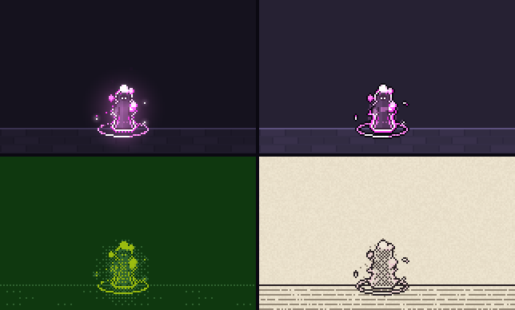

*Top: Pixel, Cel outline. Bottom: Handheld, Ink sketch.*

- **Pixel** (the default): partial transparency breaks into a Bayer dither and glow falls off smoothly.
- **Cel outline**: a toon style. Anything at least a third covered becomes a solid shape, every solid shape gets a
  one-pixel ink outline, glow is cut into three flat bands, and smoke and vapour turn into solid outlined puffs. The
  backdrop is lifted a little so the ink reads against it.
- **Handheld**: four shades of one green, like an old handheld screen. Each pixel's brightness picks a shade, and the
  4 × 4 Bayer pattern chooses between neighbouring shades, so glow and smoke still fade in dithered steps.
- **Ink sketch**: drawn on grainy paper. Every solid shape gets an ink outline and cross-hatching that thickens as its
  colour darkens, so white-hot cores stay bare paper; glow becomes a light hatch that fades to stipple; the ground is
  ruled in light ink. A faint wash of the palette keeps a hint of each effect's colour. On a transparent sheet the
  paper drops away and the ink and filled shapes remain.

In the **Handheld** and **Ink sketch** looks the effect's own colours only decide how light or dark each pixel is, so
the editor's palette switches to the look's colours: the four screen shades, or paper, outline ink, hatching and light
ink. Hue, saturation and each swatch change those instead (an amber or blue screen, blue ink on cream), the palette
strip in the notes and the page's accent colour follow, and **Reset to the seed** puts them back. These colours belong
to the look rather than the effect, so they stay as you generate new effects, and the link keeps them (`lhue`, `lsat`,
`l0`–`l3`, for example `#s20482~lhue:120,look:handheld`). Exports list them in their JSON as `"lookPalette"`.

The look is kept in the link (`#s20482~look:cel`), stays on as you generate new effects, and applies to the
variations strip and to exports, whose files get the look in their name (`-cel`, `-handheld`, `-ink`) and `"look"` in their JSON.

## Exporting

Pick a frame rate (12, 24 or 30 fps) and a scale (1×, 2× or 4×), then download:

- **Sprite sheet PNG.** The frames in a near-square grid, on a transparent ground or on the page's backdrop. On a
  transparent ground the glow becomes alpha, which is exact over black and close over any dark background.
- **Sheet JSON.** Aseprite's array format (frame rects, per-frame durations in milliseconds, one frame tag), so
  engines and importers that read Aseprite sheets can load it. An extra `effect` block gives the fps, the loop
  flag, the contact frame, the camera shake and the full recipe.
- **GIF.** Looks like the page, backdrop and screen shake included, and loops forever. It uses one palette of up to
  256 colours, reduced by median cut when the effect has more.

A loop exports exactly one period and repeats with no seam. A one-shot runs to its empty last frame, and one frame
always lands on contact so the white hero frame is never skipped. The sheet leaves the screen shake out so a game
can move its camera instead. Exports follow the page's dither and hit-stop settings. Frame lengths are rounded to
whole milliseconds (or hundredths of a second in the GIF) but always add up to the exact running time.

## How it draws

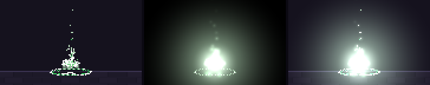

*Color buffer · light buffer · final image.*

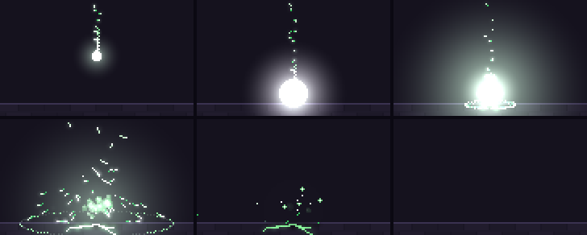

*A one-shot from start to finish: the anticipation, the white hero frame on contact, release, spread, hold, and the
empty last frame.*

- **Two buffers.** Hard pixels go into a color buffer; glow goes into a light buffer that is added on top at the end.
- **Ordered dither.** Partial transparency is a 4 × 4 Bayer pattern, not blending. Smoke, vapour and dust are the
  exception: they are truly translucent soft discs.
- **Stepped ramps.** Code picks one step of the palette and never blends between two.
- **Physics for one-shots.** Particles step at a fixed 120 Hz from a seeded random sequence, so the same seed always
  plays the same frames, and scrubbing backwards returns the same frame.
- **Time for loops.** Every loop frame is computed from the time alone, wrapped at the period. Each moving part runs
  a whole number of cycles per period, so the last frame flows into the first.
- **Choreography.** One-shots run anticipation, a white hero frame with a hit-stop and screen shake, release, spread,
  hold and decay, and end on an empty frame.

## Credits

The drawing techniques (two buffers, ordered dither, stepped ramps) and the spark, flame and smoke particle styles
were studied from [patch-gg/pixelfx](https://github.com/patch-gg/pixelfx) and
[Sprite Fusion's pixel art VFX](https://www.spritefusion.com/pixel-art-vfx) by Hugo Duprez, both MIT licensed.
No code from either is included here.
